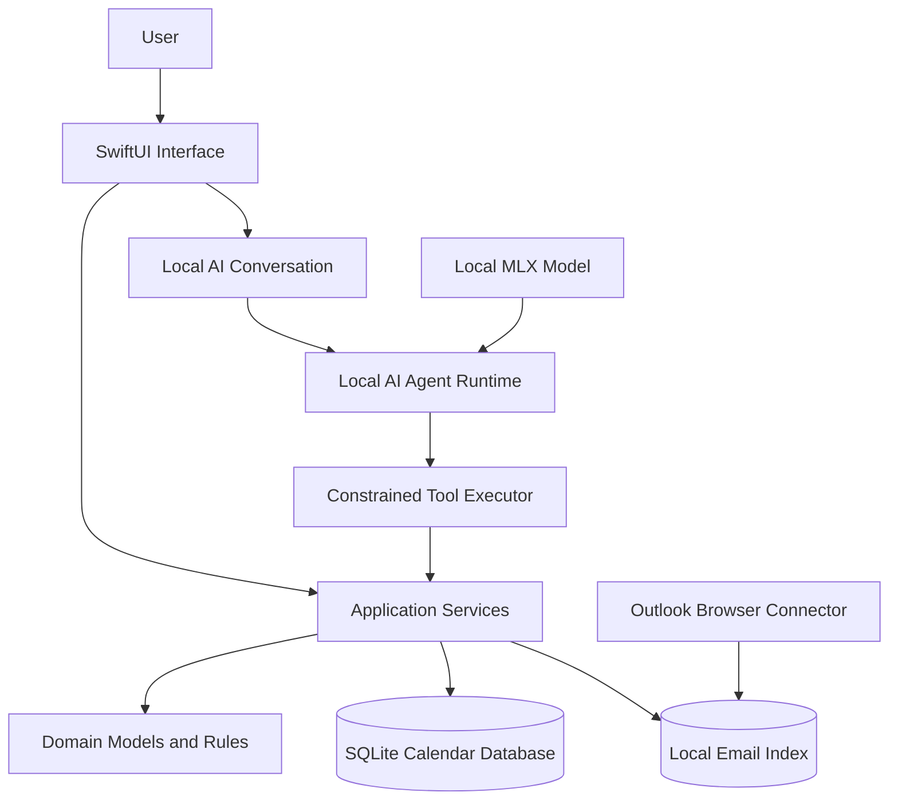

# PersonalCalendar Project Overview

## 1. Product Positioning

PersonalCalendar is more than a calendar with a chat box. It is a local personal time-management workspace.

It brings three kinds of information into one actionable context:

1. Events and tasks created explicitly by the user.
2. Meetings, classes, deadlines, and action items found in email.
3. Conversations and planning sessions between the user and a local LLM.

The user does not need to remember which message or date contains a piece of information. They can describe the goal instead. The system searches local data, explains what it finds, proposes a schedule, and performs calendar actions through explicit tool calls.

## 2. Problem Statement

Traditional calendars require users to know what they want to create and manually fill in every field. Email is effective at delivering information but poor at converting that information into an actionable schedule.

PersonalCalendar is designed to shorten this workflow:

```text
Receive an email → Understand it → Find the date → Check conflicts → Create an event → Schedule preparation
```

A user should be able to say:

> Find the professor’s latest email about the final presentation. If it includes a date and time, prepare a calendar event. If it conflicts with an existing event, show me possible alternatives first.

The system separates the request into search, extraction, conflict checking, and event drafting. It does not allow the model to modify data freely.

## 3. Core User Scenarios

### Scenario A: Find Important Dates in Email

The user asks about a course, sender, or project. The assistant searches the local email index, returns matching messages, and extracts dates, times, locations, and action items.

### Scenario B: Create an Event with Natural Language

The user says, “Schedule one hour at the bank next Friday at 4:00 PM.” The assistant resolves the date and time zone, checks for conflicts, prepares an event draft, and writes it only after confirmation.

### Scenario C: Find Available Time

The user specifies a date range, duration, and constraints such as “weekday afternoons” and “at least two uninterrupted hours.” The system queries the local calendar and returns candidate time slots instead of asking the LLM to guess.

### Scenario D: Turn an Email into a Plan

The user selects an email that contains a meeting or deadline. The assistant can prepare a meeting event, advance preparation tasks, and notes linked to the original message.

### Scenario E: Review and Plan

The assistant summarizes today, the coming week, or a selected project. It can highlight overloaded days, overdue tasks, and events that may need to be rescheduled.

## 4. Design Principles

### Local-First

Calendar data, tasks, the email index, model conversations, and most processing remain on the local machine. Network access is a capability of specific connectors, not a requirement for the application to run.

### Deterministic Tools

The LLM interprets language and organizes plans. Database queries, time calculations, conflict detection, and data writes are handled by deterministic application tools.

### Human Confirmation

Read-only queries may run immediately. Before creating, editing, deleting, or moving events in bulk, the application should present a clear summary of the proposed changes.

### Source-Grounded Answers

Answers involving email or calendar facts must be based on retrieved records. If evidence is unavailable, the model should say that it is uncertain or request more context.

### Graceful Degradation

The basic calendar and task features should remain available when the local model is missing, the model service is stopped, or the email connector is unavailable.

## 5. System Architecture

PersonalCalendar uses a layered structure to isolate the interface, business rules, AI tools, and external connectors.



### UI Layer

The UI layer provides calendar views, an event editor, a search sidebar, an inspector, a task-completion dashboard, and the local AI conversation interface. It expresses user intent but does not contain persistence or email-protocol logic.

### Application Layer

The application layer coordinates the main use cases:

- Query and edit the personal calendar.
- Calculate time ranges and conflicts.
- Search email records.
- Manage local AI conversations.
- Restrict model output to validated tool calls.
- Convert email-derived events into calendar drafts.

### Domain Layer

The domain layer defines stable business concepts such as calendar items, task status, tags, drafts, date ranges, search criteria, and data sources. Its rules do not depend on SwiftUI, SQLite, a browser, or a specific model.

### Infrastructure Layer

The infrastructure layer provides concrete implementations:

- SQLite calendar repository.
- Email record repository and synchronization state.
- Chrome Native Messaging bridge.
- Outlook browser connector.
- Local MLX model provider.
- Local JSON conversation storage.
- Connectivity state and diagnostic logging.

## 6. Responsibilities of the Local LLM

The local LLM is well suited to:

- Understand natural-language dates and user intent.
- Divide complex questions into multiple retrieval steps.
- Extract candidate event information from email text.
- Explain scheduling conflicts and propose alternatives.
- Summarize retrieved records in natural language.

The local LLM should not:

- Execute arbitrary SQL.
- Edit database files directly.
- Invent email or calendar events that do not exist.
- Bypass permissions to inspect browser profiles.
- Perform high-impact bulk changes without confirmation.

The model may use only allowlisted application tools, such as:

```text
search_calendar
get_agenda
find_free_time
search_mail
get_mail_message
create_event_draft
update_event_draft
commit_calendar_changes
```

Every tool should have structured input, a clear permission boundary, and recordable output.

## 7. Email Search Flow

```text
User question
  ↓
The local LLM determines that email search is required
  ↓
It creates structured search criteria
  ↓
The Application layer queries the local email index
  ↓
The system returns a limited set of matching records and sources
  ↓
The LLM answers from the results or narrows the search
```

The system should not send the entire mailbox to the model without limits. It should first narrow candidates by sender, date, subject, and keyword, then provide only the necessary excerpts to the model.

When an email contains event information, the system first creates a draft:

```json
{
  "title": "Final Presentation",
  "start": "2026-12-11T15:00:00+09:00",
  "end": "2026-12-11T16:30:00+09:00",
  "location": "Hillside 0A702",
  "source": "mail",
  "requiresConfirmation": true
}
```

The draft becomes an official calendar item only after the user confirms it.

## 8. Calendar Write Flow

Every AI-initiated write operation should use the same pipeline:

1. Interpret the user’s intent.
2. Normalize date, time, time zone, and duration.
3. Validate required fields.
4. Query the existing calendar and detect conflicts.
5. Generate a change draft.
6. Show the user what will be added, edited, or deleted.
7. Obtain user confirmation.
8. Write to SQLite through an Application Service.
9. Return the saved record and an audit result.

This flow prevents an ambiguous phrase such as “next Friday” or “remind me later” from immediately producing incorrect data.

## 9. Data and Storage

The data should be separated into the following categories:

| Data | Recommended Storage | Notes |
|---|---|---|
| Calendar and tasks | SQLite | Primary source of truth with transaction and search support |
| Email index | SQLite or structured JSON | Stores only the fields and limited content required for search |
| AI conversations | Local JSON or SQLite | Clearable and exportable; not a source of calendar facts |
| Model files | Local model directory | Kept separate from user data so models can be replaced |
| Connector state | Local JSON | Records synchronization results, errors, and health |
| Backups | Independent backup directory | Retains versioned database copies |

The main database and its backups must remain separate from model caches. Removing a model must not delete calendar data, and rebuilding the email index must not affect user-created events.

## 10. Security and Privacy Boundaries

- The email connector accesses only explicitly allowed mailbox sources and page scopes.
- It does not read browser passwords, cookie databases, or unauthorized browser profiles.
- Connector responses are validated against a protocol version and expected fields.
- All external text is treated as data. Text inside an email must never become a system instruction.
- Model tool parameters are validated and cannot contain arbitrary file paths, commands, or SQL.
- Logs must not contain passwords, access tokens, full sensitive email bodies, or unnecessary personal information.
- Users should be able to delete local conversations, rebuild the email index, and export calendar data.

## 11. Failure Modes

The system should handle the following conditions explicitly:

- The local model is missing or cannot start.
- The model produces invalid tool arguments.
- The email connector is missing, unauthorized, or offline.
- The email index is out of date.
- A date expression is ambiguous.
- A proposed event conflicts with an existing schedule.
- A SQLite write fails or the database is corrupted.

When a failure occurs, the application should preserve existing calendar data and display an understandable, recoverable error instead of silently retrying or guessing.

## 12. Non-Goals

PersonalCalendar is not currently intended to:

- Act as a full email client.
- Log into email accounts automatically or manage browser passwords.
- Schedule large numbers of events without user confirmation.
- Upload all personal content to a third-party cloud model.
- Replace system backups, version control, or professional team-calendar software.

## 13. Reconstruction Priorities

Because the original source directory has been lost, reconstruction should proceed in this order:

1. Domain models and the SQLite repository.
2. Basic SwiftUI daily and weekly views plus the event editor.
3. Search, conflict detection, and free-time calculation.
4. Local LLM conversations and the allowlisted tool executor.
5. The email index and restricted browser connector.
6. The complete email-to-event drafting and confirmation flow.
7. Tests, packaging, signing, backup, and recovery tools.

After the first stage, establish a Git baseline immediately and configure a private remote repository or another independent backup. The installed `.app` must never again be the only surviving copy.
